<div align="center">

<h1>GTA 6 HQ</h1>

**A sourced encyclopedia, a map of Leonida and a full field manual for Grand Theft Auto VI, in one small desktop app.**

<a href="https://github.com/xpbeats00-sudo/gta6-hq/releases/latest"></a>
<a href="https://github.com/xpbeats00-sudo/gta6-hq/releases/latest"></a>
<a href="https://github.com/xpbeats00-sudo/gta6-hq/releases/latest"></a>

[](https://github.com/xpbeats00-sudo/gta6-hq/releases/latest)
[](https://github.com/xpbeats00-sudo/gta6-hq/releases)
[](https://discord.gg/YhMHr8N4an)


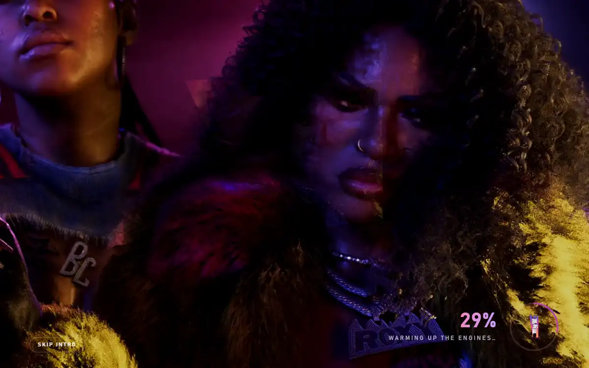

[What's inside](#whats-inside) · [Start-up](#pick-your-start-up) · [Field Manual](#the-field-manual) · [Install](#install) · [What's new](#whats-new) · [Questions](#questions) · [Developers](#for-developers)

</div>

> **Unofficial fan project.** Not published, approved or endorsed by Rockstar Games or Take-Two Interactive. Every entry says where it comes from: Rockstar's own material is labelled **Official**, guides, reviews and other reporting **Community**, and story discoveries made after launch are blurred as spoilers until you choose to see them.

<a id="whats-inside"></a>
<p align="center"></p>

<table>
<tr>
<td width="50%" valign="top">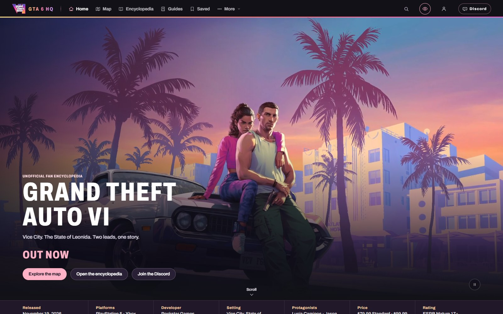<br><b>Home</b><br>Live wallpapers, the latest news, and a Track and plan row for playing along.</td>
<td width="50%" valign="top">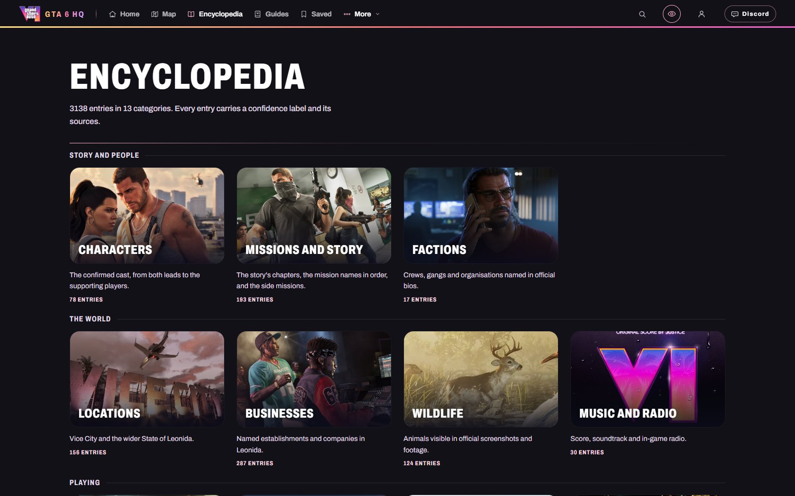<br><b>Encyclopedia</b><br>Characters, missions, places, businesses, vehicles, weapons, wildlife, music and more, each entry with its sources.</td>
</tr>
<tr>
<td valign="top">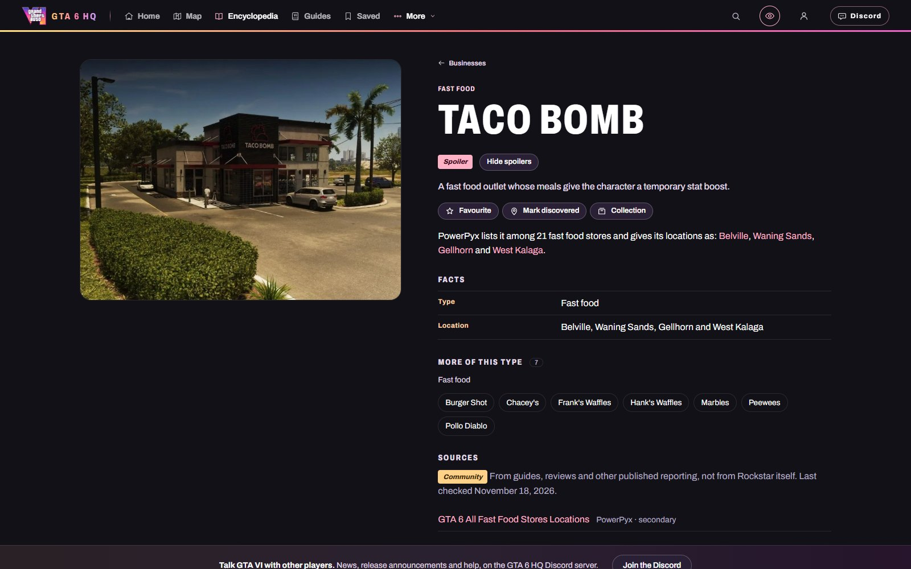<br><b>Entry pages</b><br>Facts, links to the people and places named, more of the same type, and where each fact comes from.</td>
<td valign="top">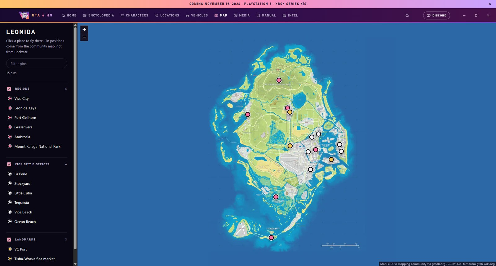<br><b>Map of Leonida</b><br>Every place pinned and grouped with found counts, a 100% objectives filter, robbery runs that follow the roads, and a 3D view.</td>
</tr>
<tr>
<td valign="top">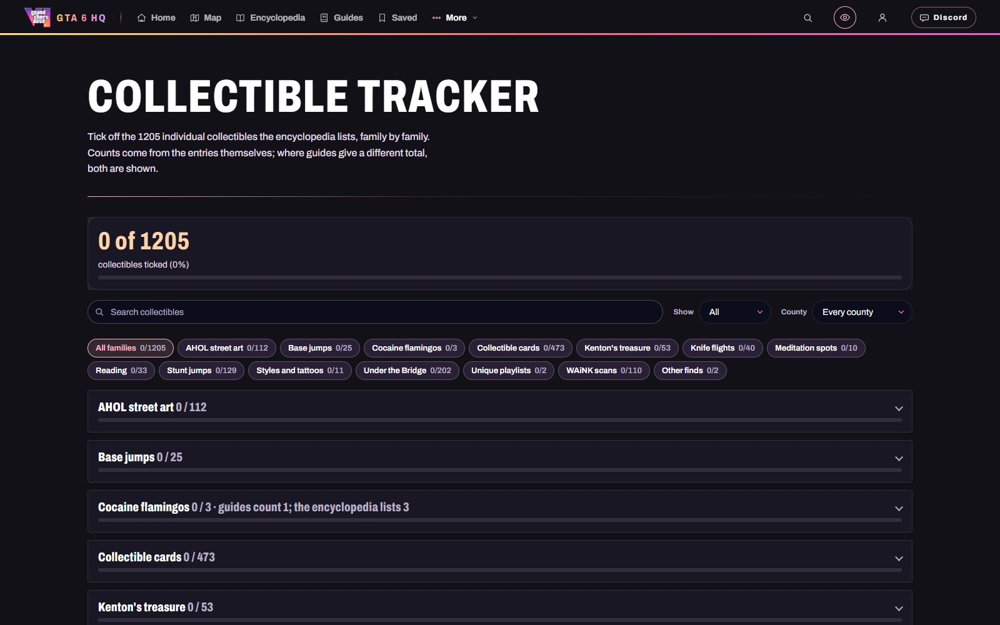<br><b>Collectible Tracker</b><br>Tick off every collectible, family by family and county by county.</td>
<td valign="top">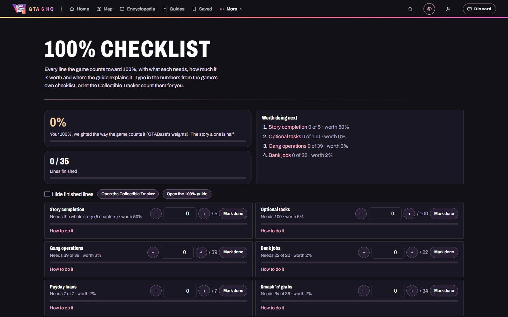<br><b>100% Checklist</b><br>Every line the game counts toward 100%, with your counts and what to do next.</td>
</tr>
<tr>
<td valign="top">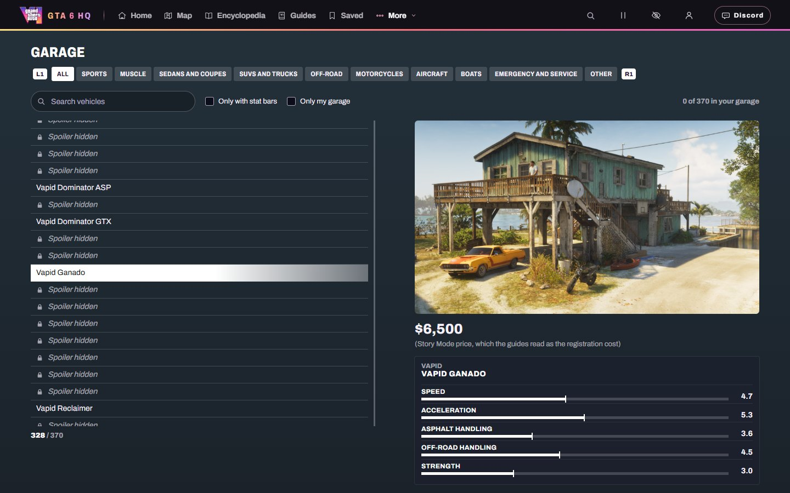<br><b>Garage and Weapon Locker</b><br>The game's own stat bars for vehicles and weapons, side-by-side compare and full prices.</td>
<td valign="top">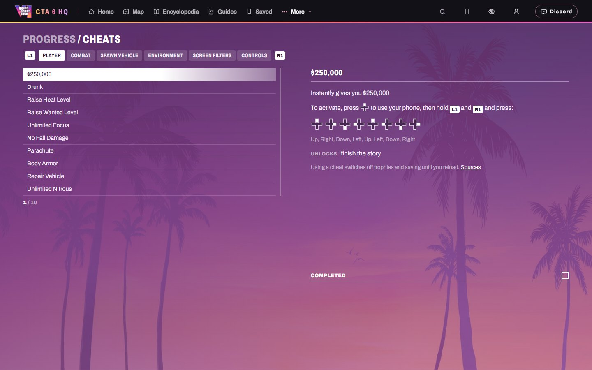<br><b>Cheats and Controls</b><br>Every cheat code as D-pad arrows, and a controller diagram for PlayStation and Xbox.</td>
</tr>
<tr>
<td valign="top">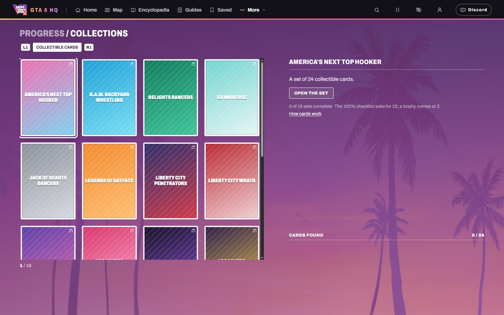<br><b>Card Collections</b><br>All 18 card sets, card by card, ticked in step with the tracker.</td>
<td valign="top">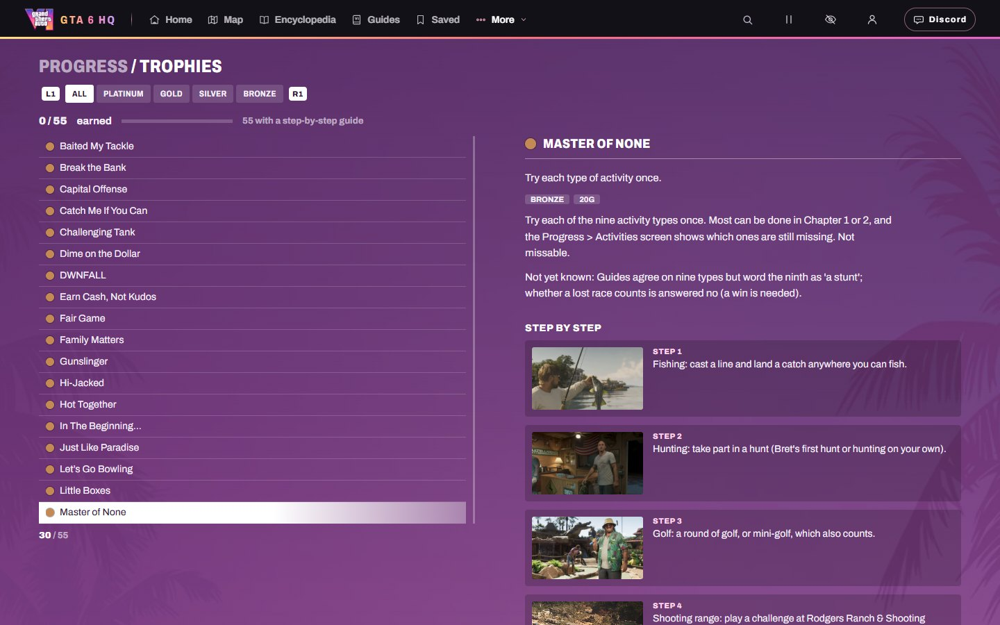<br><b>Trophy Guides</b><br>Step-by-step guides with a picture for each step.</td>
</tr>
</table>

Also in the app:

- **Garage** and **Weapon Locker**: the game's stat bars for 341 vehicles and 194 weapons, side-by-side compare, full prices, and your own garage and locker.
- **Card Collections**: all 18 card sets, card by card.
- **Cheats and Controls**: every cheat code, and a controller diagram for PlayStation and Xbox.
- **Trophy Guides**: step-by-step guides with pictures.
- **Help**: the Field Manual's topics, laid out like the game's Help menu.
- A **pause menu** on Esc, **Intel** (release timeline and editions), **search** across everything, a **Discovery Journal**, **Saved** favourites and collections, and separate progress for Jason and Lucia.

Everything you save stays on your computer.

<a id="pick-your-start-up"></a>
<p align="center"></p>

<table>
<tr>
<td width="50%" valign="top">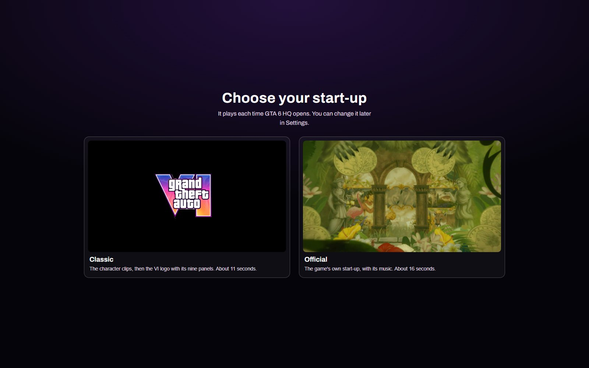</td>
<td width="50%" valign="top">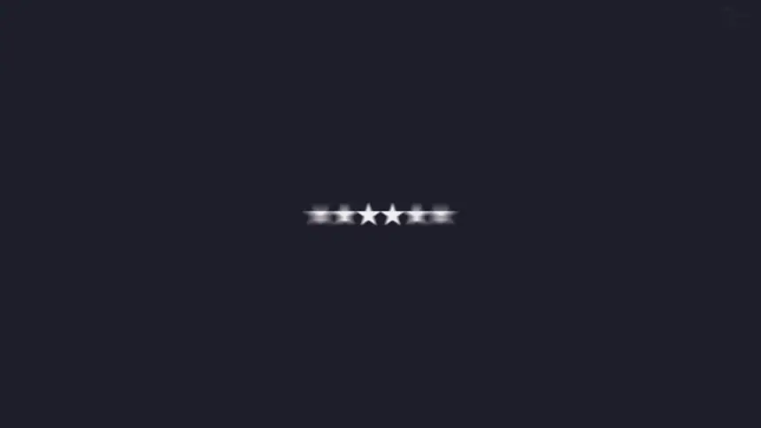</td>
</tr>
</table>

The first time the app opens, both intros play side by side and you pick one: **Classic**, the character clips and the VI logo with its nine panels, or **Official**, the game's own start-up with its music. Change it any time in **Settings → Start-up**, and skip it with Esc or Enter.

<a id="the-field-manual"></a>
<p align="center"></p>

<div align="center">
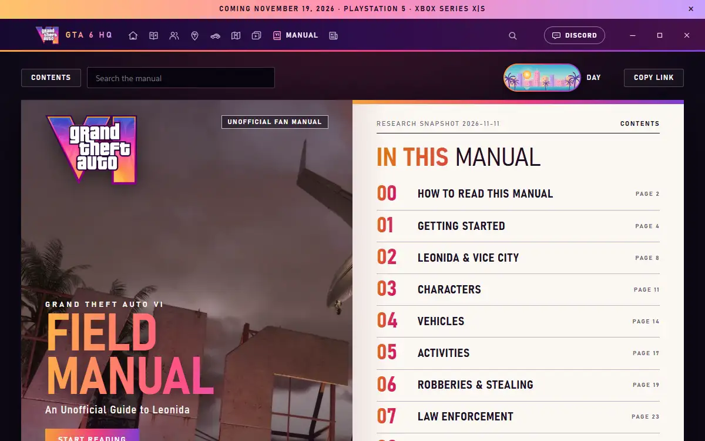
</div>

A 229-page manual in 23 chapters, written like the one that used to come in the box: getting started, story and missions, Leonida, robberies and stealing, the police, money and businesses, and a 100% Guide with safe codes and walkthroughs. Two-page spreads, search, night reading, and every picture opens full screen.

<a id="install"></a>
<p align="center"></p>

**Windows 10 and 11:** download `GTA6HQ-<version>-Setup.exe` from the [latest release](https://github.com/xpbeats00-sudo/gta6-hq/releases/latest) and run it. It installs for your account only, with no administrator prompt, then opens from the Start menu. Prefer no installer? The portable zip from the same page runs from any folder.

<details>
<summary><b>macOS (preview)</b></summary>

Download `GTA6HQ-<version>-macos.zip`, open it and drag **GTA 6 HQ** into Applications. It runs on Apple silicon and Intel Macs with macOS 11 or later. The app is not signed with an Apple developer account, so the first time macOS refuses to open it: go to System Settings → Privacy & Security, scroll down and choose **Open Anyway**.
</details>

<details>
<summary><b>Linux (preview)</b></summary>

Download `GTA6HQ-<version>-linux-x86_64.tar.gz`, extract it and run `./gta6-hq` inside the `GTA6HQ` folder; `./install.sh` adds it to your applications menu. It needs WebKitGTK 4.1 (usually `libwebkit2gtk-4.1-0` or `webkit2gtk4.1`) and a distribution at least as recent as Ubuntu 22.04.
</details>

<details>
<summary><b>"Windows protected your PC", and updating</b></summary>

The app is not code-signed, so SmartScreen may warn the first time: choose **More info**, then **Run anyway**. Each release has a `SHA256SUMS.txt` to check the download against.

When a new version is out, the app says so. In an installed copy, **Update now** downloads the new setup, checks it against the release's checksums and installs it while the app restarts. Nothing downloads unless you press the button. The macOS and Linux versions link to the new release instead.

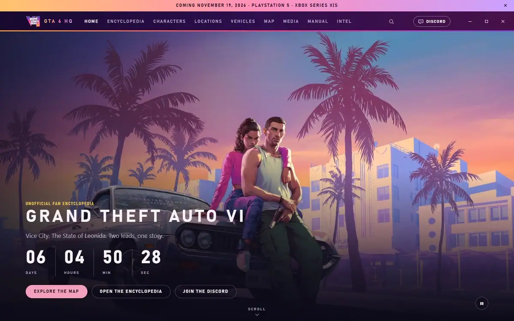
</details>

<details>
<summary><b>See it on Windows, macOS and Linux</b></summary>

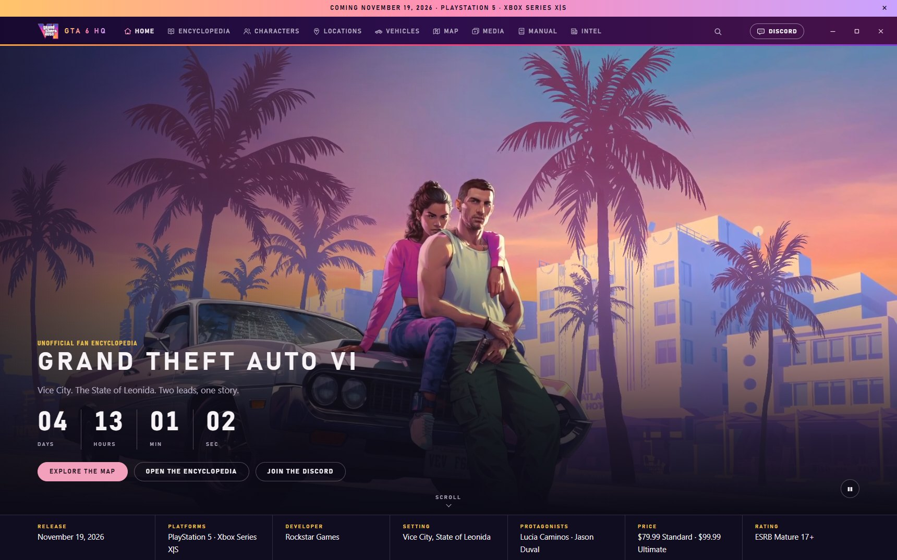
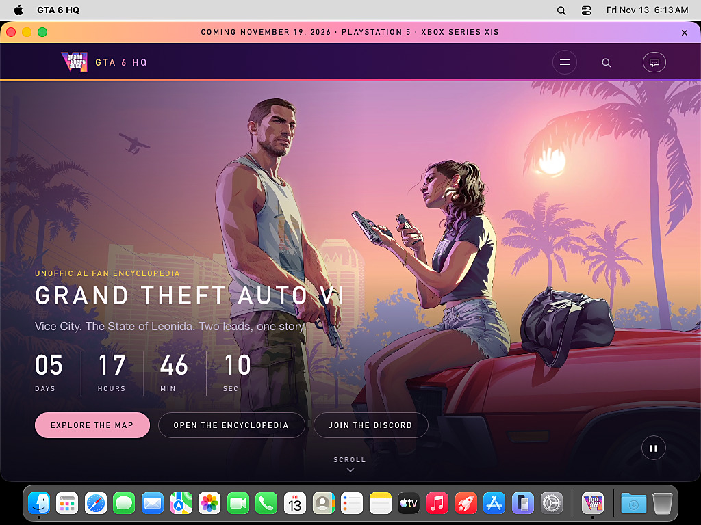
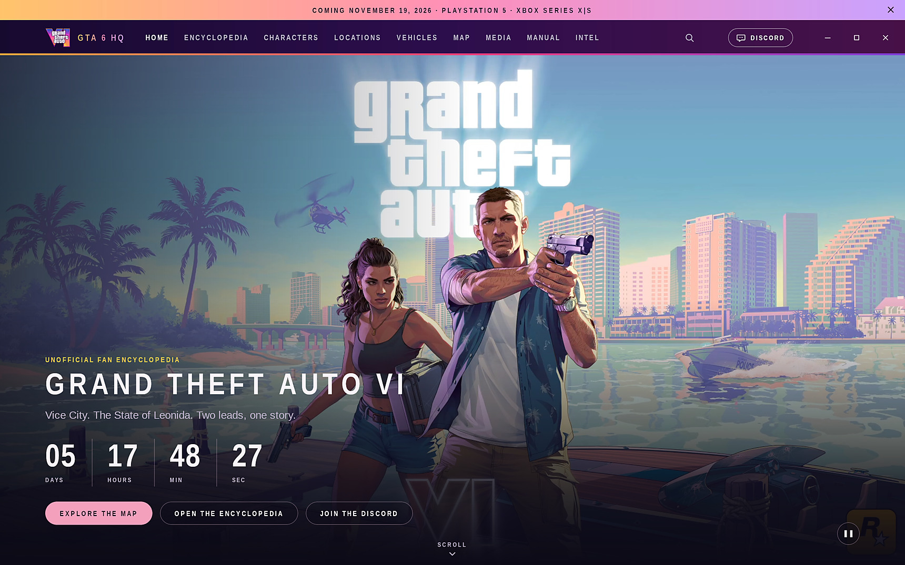
</details>

<a id="whats-new"></a>
<p align="center"></p>

- **0.2.46**: a map and menus that look like the game's, a Garage and Weapon Locker with stat bars, Card Collections, Cheats and Controls, Trophy Guides, and 74 cleaner, sharper pictures.
- **0.2.45**: all 40 gang operations on the map, a safe code for every safe, and entry pages that link the people and places they mention.
- **0.2.44**: choose your start-up (Classic or the game's own Official intro), 49 new pictures, voice actors for the cast, the latest news and checked facts.
- **0.2.43**: 63 new pictures, and pictures removed for site logos no longer come back on installed copies.
- **0.2.42**: a "Track and plan" row on Home, a "What's here" panel on every place, a tidier Saved page and styled jump buttons.
- **0.2.41**: routes that follow the roads, lists you can group (by type, county, maker, grade, lead or habitat), pages that link to each other, and a tidier Intel, Missions and map.

<details>
<summary>Earlier versions</summary>

- **0.2.40**: 123 new pictures, a progress backup, missions in story order, map tracking (hide discovered, Next, Only), a 100% Checklist and safe codes.
- **0.2.39**: the Rockstar GTA VI guide look, 42 new entries, 56 new and 110 sharper pictures, and cleaner sources.
- **0.2.38**: a Robbery Planner guide with map runs, smarter search, sharper pictures and better sources.
- **0.2.37**: a simpler look (five-link top bar, sentence case, six text sizes), Official and Community labels on every entry and picture, and an "Official only" switch.
- **0.2.36**: every picture, logo, clip and wallpaper is back in the download, with everything new in 0.2.35.
- **0.2.35**: the Map Explorer (3D map, Street Explorer, Discovery Journal), a new look and the audit fixes; downloads no longer include game pictures, logos or clips.
- **0.2.34**: 120 watermarked pictures replaced with clean ones, 23 new pictures (2,717 entries with one).
- **0.2.33**: 40 more sourced pictures (2,696 entries with one); the Nagasaki Dinghy folded into the Dingus Como.
- **0.2.32**: the Field Manual rewritten for the released game: 14 chapters, 86 pages, 211 pictures, chapter title pages and tabs.
- **0.2.31**: 3,086 entries; 33 fish and new birds, weapon and vehicle pictures, nine duplicates merged, launch-evening news.
- **0.2.30**: 3,051 entries; 66 standout vehicles, landmarks, mission screenshots, Easter eggs and launch-day news.
- **0.2.29**: the Florida panther and Nuestra Señora de la Noche pictures are back on their own entries.
- **0.2.28**: 2,928 entries, collectible cards, stunts, knife flights and basketball hoops with its location, the official credits and more radio songs.
- **0.2.27**: pictures for 1,282 entries, each tied to its entry by name and none repeated; 210 weapons with every named variant; shipwrecks, WAiNK spots, more animals and launch news.
- **0.2.26**: the game is out: 1,471 entries (295 vehicles, 174 missions, 364 places and businesses, 84 weapons, all 22 radio stations), a Field Manual checked against launch coverage, and 130 new vehicle pictures.
- **0.2.25**: the launch update: an Achievements section with all 55 trophies and their icons, missions by chapter, collectibles and the 100% checklist, cheats, challenges, and what launch reviews report, with post-launch details marked as spoilers.
- **0.2.24**: a first-open spoiler warning, spoilers blurred under an eye button, and settings that are kept across restarts and updates.
- **0.2.23**: 46 more pictures from Rockstar's editions page in the gallery, and cover art on the edition cards in Intel.
- **0.2.22**: new preview details from TGG's pre-launch guide: ten new Field Manual pages and 18 new encyclopedia entries, all labelled as preview reports.
- **0.2.21**: 28 new live wallpapers on Home, a new intro with the character clips, icons in the top bar, and measured speed and memory fixes.
- **0.2.20**: evidence labels restyled as tags, with "R★ Verified" for anything from Rockstar's own published material.
- **0.2.19**: a smoother intro, with each panel gliding in and slowing to a stop.
- **0.2.18**: a new intro built from the cover art, and updates found while the app stays open.
- **0.2.17**: fan-compiled lists of vehicles, weapons, brands and minor characters, marked as community research, plus the last gaps from Rockstar's own posts.
- **0.2.16**: launch time, boxed-copy details and fan-recorded place names, each labelled by source.
- **0.2.15**: a picture for Lori's entry, marked as an unconfirmed identification.
- **0.2.14**: the latest official news on the Intel timeline: The Festival, the frame rate, Xbox Cloud Gaming and the launch-day poster.
- **0.2.13**: replaces 0.2.12, which Windows Security wrongly flagged and removed.
- **0.2.12**: the Update now button in the update notice looks right again.
- **0.2.11**: more official detail on the music, editions, rating and PlayStation 5 version, and three new entries.
- **0.2.10**: the Field Manual's day and night switch is a small Vice City scene, and the new look spreads across the page from it.
- **0.2.9**: the splash screen dissolves smoothly into Home.
- **0.2.8**: the police lights flash at a real emergency-lamp rate, and the update stage is easier to read.
- **0.2.7**: the app can update itself from Home, with police lights down the sides while it does.
- **0.2.6**: the Discord invitation on Home has a changing wallpaper, the server's icon and the Discord logo.
- **0.2.5**: Setup no longer leaves a stray folder beside the setup file.
- **0.2.4**: a new setup window in the app's look, Discord invitations on Home and above the footer, and click-to-reveal spoilers.
- **0.2.3**: a link to the [community Discord server](https://discord.gg/YhMHr8N4an) in the top bar, on Home and in the footer.
- **0.2.2**: stricter security for the app's pages, and manual pictures can be opened from the keyboard.
- **0.2.1**: Home plays every live wallpaper in turn, pictures drift slowly, and the full-screen picture viewer is fixed.
- **0.2.0**: a new look with the app's own window buttons, a 38-page manual with two new chapters, and pictures across the encyclopedia.
</details>

The full list is in [CHANGELOG.md](CHANGELOG.md), and every version is on the [releases page](https://github.com/xpbeats00-sudo/gta6-hq/releases).

<a id="creators-welcome"></a>
<p align="center"></p>

Download it, review it, stream it, make videos about it. You do not need to ask. Call it **unofficial** or **fan-made**, link the [download](https://github.com/xpbeats00-sudo/gta6-hq/releases/latest) so people get the real file, and take a description and screenshots from the [press kit](docs/press/README.md). Made something? Post it in the [Discord server](https://discord.gg/YhMHr8N4an).

<a id="questions"></a>
<p align="center"></p>

<details>
<summary><b>Windows says it "protected my PC". Is the app safe?</b></summary>

The app is not code-signed, because signing costs money, so Windows SmartScreen warns about it the first time. Choose **More info**, then **Run anyway**. Each release has a `SHA256SUMS.txt` you can check the download against, and all the code is in this repository.
</details>

<details>
<summary><b>Is this made by Rockstar?</b></summary>

No. It is a fan project, not published, approved or endorsed by Rockstar Games or Take-Two Interactive.
</details>

<details>
<summary><b>How do I update?</b></summary>

When a newer version exists, the app shows a notice. From version 0.2.7, an installed copy can update itself: press **Update now** and the app downloads the new setup, checks it, closes, updates and opens again. On an older version or a portable copy, download the new setup or zip from the releases page; the setup installs over the old version. Nothing updates unless you ask.
</details>

<details>
<summary><b>How do I uninstall it?</b></summary>

Windows Settings → Apps → Installed apps → GTA 6 HQ → Uninstall, or "Uninstall GTA 6 HQ" in the Start menu. The portable version is removed by deleting its folder.
</details>

<details>
<summary><b>The map is blank or has missing squares.</b></summary>

The map downloads each area from gta6-wiki.org the first time you look at it, so it needs an internet connection then. Areas you have already viewed work offline.
</details>

<details>
<summary><b>The app will not open.</b></summary>

It needs the Microsoft Edge WebView2 Runtime. Windows 11 includes it; on Windows 10, install it from Microsoft's website and try again.
</details>

<details>
<summary><b>Can I stop it showing on my Discord profile, or checking for updates?</b></summary>

Yes. In the app's folder, open `data/discord.json` or `data/update.json` and set `"enabled": false`, then restart the app.
</details>

<details>
<summary><b>Something in the encyclopedia or manual is wrong.</b></summary>

Please [open an issue](https://github.com/xpbeats00-sudo/gta6-hq/issues/new/choose) and say where you saw it and what your source is. Corrections from your own game are welcome.
</details>

<a id="how-far-to-trust-it"></a>
<p align="center"></p>

Nothing is written from memory or carried over from earlier games. Every entry lists its sources and carries a label:

| Label | Meaning |
|---|---|
| **Official** | Stated by Rockstar Games in its own published material |
| **Community** | From guides, reviews and other published reporting, not from Rockstar itself |
| **Spoiler** | A story discovery made after launch, blurred until you choose to see it |

Where sources disagree, the entry says so and names both. The Field Manual marks each claim with how it is known, and the evidence behind it is in [`docs/manual/research/`](docs/manual/research/). Found something wrong? [Open an issue](https://github.com/xpbeats00-sudo/gta6-hq/issues/new/choose) and say where you saw it.

<a id="privacy"></a>
<p align="center"></p>

- No account, no telemetry, no analytics.
- The app asks GitHub whether a newer version exists, and the map downloads its tiles from gta6-wiki.org the first time each area is viewed.
- If Discord is running, the app can show "GTA 6 HQ" and the page you are reading on your profile.

The update check and the Discord status can each be turned off in the app's `data` folder. Details: [`docs/architecture/NETWORK-AND-PRIVACY.md`](docs/architecture/NETWORK-AND-PRIVACY.md).

<a id="credits-and-rights"></a>
<p align="center"></p>

- **Pictures, footage frames and artwork** are official Rockstar Games material and remain the property of Rockstar Games and Take-Two Interactive. Their source and rights status are recorded per file in `data/media.json`; none is licensed for redistribution, as [`docs/compliance/MEDIA-RIGHTS-AUDIT.md`](docs/compliance/MEDIA-RIGHTS-AUDIT.md) sets out. If you are a rights holder and want something removed, [open a rights request](https://github.com/xpbeats00-sudo/gta6-hq/issues/new/choose).
- **Map tiles**: the GTA VI mapping community via gtadb.org, CC BY 4.0, served by gta6-wiki.org and cached locally on first view.
- **Live wallpapers and the logo** were supplied by the app's owner; where they first came from is not recorded.

Grand Theft Auto and related names are trademarks of their owners.

<a id="for-developers"></a>
<p align="center"></p>

<details>
<summary>Building, adding content and how it is put together</summary>

### Run it from source

```bash
cargo run --release
```

The window opens on the splash video, then the app. The built program is
`target/release/gta6-hq.exe`; it needs the `ui`, `data`, `images` and
`wallpapers` folders, which it finds by looking upwards from where it sits.
It needs the Microsoft Edge WebView2 Runtime, which Windows 11 includes.

Other ways to start it:

| Command | What it does |
| --- | --- |
| `gta6-hq --serve --port 4600` | Server only; open `http://127.0.0.1:4600` in a browser |
| `gta6-hq --validate` | Print the data integrity report; exit code 1 if there are errors |
| `gta6-hq --template <category>` | Print an empty entry for that category, ready to fill in (`--csv` prints a CSV header row instead) |
| `gta6-hq --import <file> [--dry-run] [--update]` | Check a JSON or CSV batch of entries and add it; refuses the whole batch if anything is wrong |

The release program has no console window. In PowerShell, end these commands
with `| Out-Host` so the output is shown and `$LASTEXITCODE` is set, for example
`.\target\release\gta6-hq.exe --validate | Out-Host`. `cargo run -- --validate`
works as it is.

### Adding content

Read `docs/Raw/EDITORIAL_POLICY.md` first: nothing goes in without a source.
For adding a lot at once, read `docs/Raw/LAUNCH-READINESS.md`.

- **Text**: edit `data/wiki.json`, or a section file in `data/wiki/` (see
  below), and refresh. No rebuild needed. If a file has a mistake in it, the
  app says so: a broken `data/wiki.json` is replaced by the built-in copy, a
  broken section file is left out.
- **Section files**: `data/wiki/<category>.json` holds a list of entries that
  is added to that category, so a big category does not have to live in one
  huge file (`vehicles.boats.json` also counts as `vehicles`).
  `data/wiki/sources.json` adds sources. `--import` writes these files for you.
- **Many entries at once**: `gta6-hq --template vehicles` prints an entry to
  fill in; `gta6-hq --import batch.json --dry-run` checks a batch;
  without `--dry-run` it is added, after a backup in `backups/`.
- **A new category**: add it to `categories` in `data/wiki.json`, with the
  `fields` its entries may carry under `facts`.
- **A map pin**: give an entry `x` and `y` (0 to 1) and it appears on the map.
  Pin types are listed under `map.categories`.
- **Pictures for an entry**: save as `images/<section>/<slug>.jpg` (or png/webp),
  e.g. `images/characters/cal-hampton.jpg`. Entries without a picture get
  generated postcard art.
- **Gallery**: put new files in `staging/` (never shown), then move them to
  `images/` or `wallpapers/` and add a record to `data/media.json`.
- Run `cargo run -- --validate` afterwards.

### Discord Rich Presence

While the app window is open, your Discord status shows GTA 6 HQ, the page
you are on and how long the app has been open. Settings are in
`data/discord.json`:

| Setting | Meaning |
| --- | --- |
| `enabled` | `false` turns it off completely |
| `application_id` | The Application ID from the Discord Developer Portal |
| `large_image` | Name of an image uploaded under Rich Presence → Art Assets for that application |
| `show_page` | `false` shows only that the app is open, not which page |

Search terms are never sent. Discord must be running on the same computer;
if it is not, the app works as normal and retries every 15 seconds.
`http://127.0.0.1:<port>/api/presence` reports whether it is connected.
Restart the app after changing the file.

### The Discord assistant and the hosted map

On the [Discord server](https://discord.gg/YhMHr8N4an), ask anything about GTA 6 in
`#gta6-questions`, or use `/ask`, `/map`, `/vehicle`, `/weapon`, `/guide`, `/stunts`, `/completion`,
`/find` or `/sources`.

- **Where its answers come from**: the bot answers from this app's data, through the app's own
  server, so there is no second database.
- **What a reply holds**: a picture of the map, with buttons that open the
  [interactive Leonida map](https://xpbeats00-sudo.github.io/gta6-hq/map/) at the same place.
- **What the map does**: drag, zoom and go full screen.
- **What it never does**: it never guesses. If GTA 6 HQ does not have a fact, it says so.

How it works, its settings and its tests: [`docs/architecture/DISCORD-ASSISTANT.md`](docs/architecture/DISCORD-ASSISTANT.md).

### How it is built

| File | Job |
| --- | --- |
| `src/main.rs` | Starts the server, then the window (or `--serve` / `--validate`) |
| `src/window.rs` | Native window (tao) with a web view (wry / WebView2) |
| `src/server.rs` | Routes: `/api/wiki`, `/api/search`, `/api/media`, `/api/health`, `/tiles/…`, static files |
| `src/content.rs` | Loads `data/wiki.json` and `data/wiki/*.json`, attaches entry images, keeps the result in memory until a file changes |
| `src/search.rs` | Word index built once per load; ranking, filters, paging |
| `src/import.rs` | `--template` and `--import`: batch checks, backups, atomic writes |
| `src/media.rs` | Scans `images/` and `wallpapers/`, joins the rights manifest |
| `src/validate.rs` | Data and media integrity report (also used by `--import`) |
| `src/tiles.rs` | Fetches map tiles once and caches them in `cache/tiles/` |
| `src/discord.rs` | Discord Rich Presence over Discord's local connection |
| `ui/` | The interface (HTML, CSS, JavaScript, Leaflet) |

Checks: `cargo test`, `cargo clippy --all-targets --all-features -- -D warnings`,
`cargo fmt --all -- --check`, `node --check ui/app.js`.

`/api/search` answers `{ total, offset, limit, hits }` and takes `q`, `section`,
`limit` (default 50, at most 200), `offset`, `sort=name`, `rumors=true` and
`spoilers=true`. `/api/wiki` has the same shape as before, minus draft entries.


### Project status and reports

Start with [docs/status/CURRENT-STATE.md](docs/status/CURRENT-STATE.md). It is generated from the live data:

```
python scripts/current_state.py --run-checks
python scripts/audit_media.py
```

[docs/status/REPORT-INDEX.md](docs/status/REPORT-INDEX.md) lists every report and says which are current and which are history.

### Publishing an update

Releases are published at https://github.com/xpbeats00-sudo/gta6-hq/releases. When the app opens it asks GitHub whether a newer release exists and, if so, shows a notice with a link; nothing is downloaded or installed automatically. To turn the check off, set `"enabled": false` in `data/update.json`.

To publish a new version: raise `version` in `Cargo.toml` and `Cargo.lock`, add the version to `CHANGELOG.md` and "What's new", run `cargo build --release` and `python scripts/audit_media.py`, then `python scripts/package_release.py`. That builds the full app, with every picture, logo, clip and wallpaper, and writes its installer (`installer/gta6-hq.iss`, needs Inno Setup 6), portable zip and checksums to `dist/`. Attach all three to a new GitHub release tagged `v<version>`; CI adds the macOS and Linux packages.

Releases always ship every picture: the owner decided this on 2026-11-22 (`docs/compliance/MEDIA-DISTRIBUTION-POLICY.md`). The rights side is still open: the media records list each picture's source, and none is marked as cleared for redistribution (see the policy for what that means). `python scripts/package_release.py --no-game-media` builds an edition without the game's pictures into `dist/public/`, for testing only.

The file people download is the setup window in `installer/shell` (a small Rust program using the same window technology as the app). It carries the Inno Setup installer built from `installer/gta6-hq.iss`, runs it silently and reads its log for progress; if the window cannot open, it runs that installer with its own pages. `gta6-hq-setup.exe --demo` shows the pages without installing anything, and `python scripts/make_installer_art.py` redraws its pictures.

The installer puts the app in the user's own programs folder, so it needs no administrator access and the app can write its map cache beside itself.

</details>

<div align="center">


**GTA 6 HQ** is an unofficial fan project. [Download](https://github.com/xpbeats00-sudo/gta6-hq/releases/latest) · [Discord](https://discord.gg/YhMHr8N4an) · [Press kit](docs/press/README.md)

</div>
