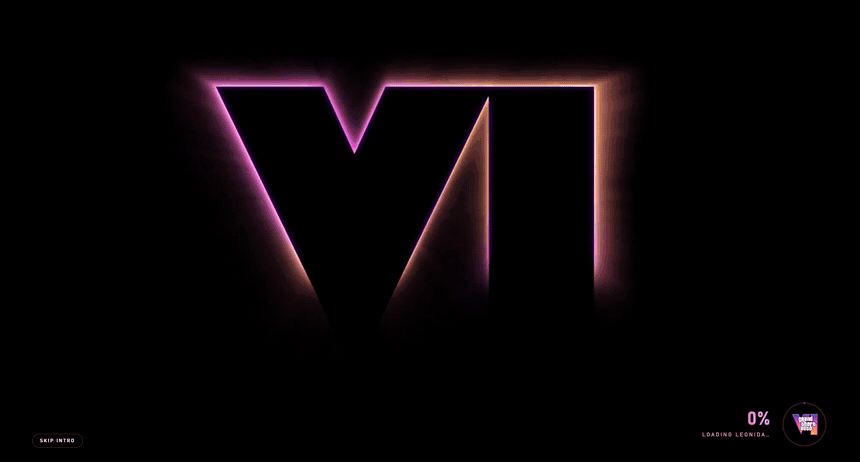
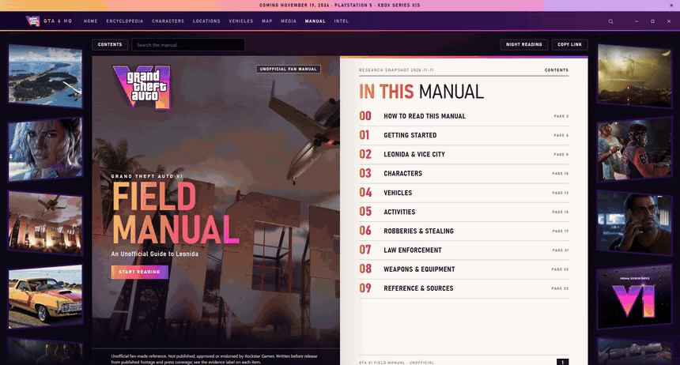

<div align="center">

# GTA 6 HQ

**An unofficial Grand Theft Auto VI encyclopedia and field manual for Windows.**
Sourced, labelled by how well each fact is supported, and built as a small Rust desktop app.



[**Download for Windows**](https://github.com/xpbeats00-sudo/gta6-hq/releases/latest) · [What's inside](#whats-inside) · [How far to trust it](#how-far-to-trust-it) · [For developers](#for-developers)

</div>

> **Unofficial fan project.** Not published, approved or endorsed by Rockstar Games or Take-Two Interactive. Everything here was written before the game's release on 19 November 2026, from official footage, Rockstar's interviews and press previews.

## Install

1. Go to the [latest release](https://github.com/xpbeats00-sudo/gta6-hq/releases/latest).
2. Download `GTA6HQ-<version>-Setup.exe` and run it. It installs for your user account only and needs no administrator access.
3. Open **GTA 6 HQ** from the Start menu.

Prefer no installer? Download the portable zip from the same page, extract it anywhere and run `gta6-hq.exe`.

The app is not code-signed, so Windows SmartScreen may show "Windows protected your PC" the first time. Choose **More info**, then **Run anyway**. Windows 11 already includes the WebView2 runtime the app needs.

When a newer version is published, the app shows a notice with a link. Nothing downloads or installs by itself.

## What's inside


| | |
|---|---|
| **Encyclopedia** | 73 entries in 12 categories: characters, locations, vehicles, gameplay, activities, wildlife, businesses, factions, music, weapons. Each entry has a confidence label and its sources. |
| **Field Manual** | A 38-page printed-style manual with two-page spreads, search and night reading. |
| **Map** | A zoomable map of Leonida with pins for regions, districts and landmarks. |
| **Media** | Every picture and video in the app, each with where it came from and its rights status. |
| **Intel** | Release timeline, editions and the questions people ask most. |
| **Search** | Ranked search across everything, with filters. |

<table>
<tr>
<td width="50%"></td>
<td width="50%"></td>
</tr>
<tr>
<td></td>
<td></td>
</tr>
<tr>
<td></td>
<td></td>
</tr>
</table>

## The Field Manual



Ten chapters, written like the manual that used to come in the box:

- **Getting Started**: what is on screen, health and food, switching between Jason and Lucia, the phone and money.
- **Robberies & Stealing**: robbing stores, safes and back doors, stealing cars, guns and fighting.
- **Law Enforcement**: the six wanted stars, the Heat icons, what the police know about you and how to lose them, built on frames from Rockstar's own footage.
- **Leonida, Characters, Vehicles, Activities, Weapons**: drawn from the encyclopedia.

Click any picture to see it full screen.

<table>
<tr>
<td width="50%"></td>
<td width="50%"></td>
</tr>
</table>

## How far to trust it

Nothing is written from memory or carried over from earlier games. Every claim in the manual carries one of these labels:

| Label | Meaning |
|---|---|
| Demonstrated | Visible in Rockstar's official footage or screenshots |
| Developer-described | Said by a Rockstar developer in an interview |
| Preview-reported | Reported by someone who saw a preview build |
| Interpretation | A reasonable reading of footage or reporting, not a confirmed rule |
| Unknown | Not established by anything read; listed, not guessed |

Every chapter was written before release, so all of it needs checking against the finished game. The evidence behind the manual is in [`docs/manual/research/`](docs/manual/research/), and the current state of the project is in [`docs/status/CURRENT-STATE.md`](docs/status/CURRENT-STATE.md).

## Privacy

- No account, no telemetry, no analytics.
- The app asks GitHub whether a newer version exists, and the map downloads its tiles from gta6-wiki.org the first time each area is viewed.
- If Discord is running, the app can show "GTA 6 HQ" and the page you are reading on your profile.

The update check and the Discord status can each be turned off in the app's `data` folder. Details: [`docs/architecture/NETWORK-AND-PRIVACY.md`](docs/architecture/NETWORK-AND-PRIVACY.md).

## Credits and rights

- **Pictures, footage frames and artwork** are official Rockstar Games material and remain the property of Rockstar Games and Take-Two Interactive. Their source and rights status are recorded per file in `data/media.json`; none is licensed for redistribution, as [`docs/compliance/MEDIA-RIGHTS-AUDIT.md`](docs/compliance/MEDIA-RIGHTS-AUDIT.md) sets out. If you are a rights holder and want something removed, open an issue.
- **Map tiles**: the GTA VI mapping community via gtadb.org, CC BY 4.0, served by gta6-wiki.org and cached locally on first view.
- **Live wallpapers and the logo** were supplied by the app's owner; where they first came from is not recorded.

Grand Theft Auto and related names are trademarks of their owners.

## For developers

<details>
<summary>Building, adding content and how it is put together</summary>

### Run it from source

```bash
cargo run --release
```

The window opens on the splash video, then the app. The built program is
`target/release/gta6-hq.exe`; it needs the `ui`, `data`, `images` and
`wallpapers` folders, which it finds by looking upwards from where it sits.
It needs the Microsoft Edge WebView2 Runtime, which Windows 11 includes.

Other ways to start it:

| Command | What it does |
| --- | --- |
| `gta6-hq --serve --port 4600` | Server only; open `http://127.0.0.1:4600` in a browser |
| `gta6-hq --validate` | Print the data integrity report; exit code 1 if there are errors |
| `gta6-hq --template <category>` | Print an empty entry for that category, ready to fill in (`--csv` prints a CSV header row instead) |
| `gta6-hq --import <file> [--dry-run] [--update]` | Check a JSON or CSV batch of entries and add it; refuses the whole batch if anything is wrong |

The release program has no console window. In PowerShell, end these commands
with `| Out-Host` so the output is shown and `$LASTEXITCODE` is set, for example
`.\target\release\gta6-hq.exe --validate | Out-Host`. `cargo run -- --validate`
works as it is.

### Adding content

Read `docs/Raw/EDITORIAL_POLICY.md` first: nothing goes in without a source.
For adding a lot at once, read `docs/Raw/LAUNCH-READINESS.md`.

- **Text**: edit `data/wiki.json`, or a section file in `data/wiki/` (see
  below), and refresh. No rebuild needed. If a file has a mistake in it, the
  app says so: a broken `data/wiki.json` is replaced by the built-in copy, a
  broken section file is left out.
- **Section files**: `data/wiki/<category>.json` holds a list of entries that
  is added to that category, so a big category does not have to live in one
  huge file (`vehicles.boats.json` also counts as `vehicles`).
  `data/wiki/sources.json` adds sources. `--import` writes these files for you.
- **Many entries at once**: `gta6-hq --template vehicles` prints an entry to
  fill in; `gta6-hq --import batch.json --dry-run` checks a batch;
  without `--dry-run` it is added, after a backup in `backups/`.
- **A new category**: add it to `categories` in `data/wiki.json`, with the
  `fields` its entries may carry under `facts`.
- **A map pin**: give an entry `x` and `y` (0 to 1) and it appears on the map.
  Pin types are listed under `map.categories`.
- **Pictures for an entry**: save as `images/<section>/<slug>.jpg` (or png/webp),
  e.g. `images/characters/cal-hampton.jpg`. Entries without a picture get
  generated postcard art.
- **Gallery**: put new files in `staging/` (never shown), then move them to
  `images/` or `wallpapers/` and add a record to `data/media.json`.
- Run `cargo run -- --validate` afterwards.

### Discord Rich Presence

While the app window is open, your Discord status shows GTA 6 HQ, the page
you are on and how long the app has been open. Settings are in
`data/discord.json`:

| Setting | Meaning |
| --- | --- |
| `enabled` | `false` turns it off completely |
| `application_id` | The Application ID from the Discord Developer Portal |
| `large_image` | Name of an image uploaded under Rich Presence → Art Assets for that application |
| `show_page` | `false` shows only that the app is open, not which page |

Search terms are never sent. Discord must be running on the same computer;
if it is not, the app works as normal and retries every 15 seconds.
`http://127.0.0.1:<port>/api/presence` reports whether it is connected.
Restart the app after changing the file.

### How it is built

| File | Job |
| --- | --- |
| `src/main.rs` | Starts the server, then the window (or `--serve` / `--validate`) |
| `src/window.rs` | Native window (tao) with a web view (wry / WebView2) |
| `src/server.rs` | Routes: `/api/wiki`, `/api/search`, `/api/media`, `/api/health`, `/tiles/…`, static files |
| `src/content.rs` | Loads `data/wiki.json` and `data/wiki/*.json`, attaches entry images, keeps the result in memory until a file changes |
| `src/search.rs` | Word index built once per load; ranking, filters, paging |
| `src/import.rs` | `--template` and `--import`: batch checks, backups, atomic writes |
| `src/media.rs` | Scans `images/` and `wallpapers/`, joins the rights manifest |
| `src/validate.rs` | Data and media integrity report (also used by `--import`) |
| `src/tiles.rs` | Fetches map tiles once and caches them in `cache/tiles/` |
| `src/discord.rs` | Discord Rich Presence over Discord's local connection |
| `ui/` | The interface (HTML, CSS, JavaScript, Leaflet) |

Checks: `cargo test`, `cargo clippy --all-targets --all-features -- -D warnings`,
`cargo fmt --all -- --check`, `node --check ui/app.js`.

`/api/search` answers `{ total, offset, limit, hits }` and takes `q`, `section`,
`limit` (default 50, at most 200), `offset`, `sort=name`, `rumors=true` and
`spoilers=true`. `/api/wiki` has the same shape as before, minus draft entries.


### Project status and reports

Start with [docs/status/CURRENT-STATE.md](docs/status/CURRENT-STATE.md). It is generated from the live data:

```
python scripts/current_state.py --run-checks
python scripts/audit_media.py
```

[docs/status/REPORT-INDEX.md](docs/status/REPORT-INDEX.md) lists every report and says which are current and which are history.

### Publishing an update

Releases are published at https://github.com/xpbeats00-sudo/gta6-hq/releases. When the app opens it asks GitHub whether a newer release exists and, if so, shows a notice with a link; nothing is downloaded or installed automatically. To turn the check off, set `"enabled": false` in `data/update.json`.

To publish a new version: raise `version` in `Cargo.toml`, run `cargo build --release` (with the app closed), then `python scripts/package_release.py`. That writes the installer (`installer/gta6-hq.iss`, needs Inno Setup 6), the portable zip and their checksums to `dist/`; attach all three to a new GitHub release tagged `v<version>`.

The installer puts the app in the user's own programs folder, so it needs no administrator access and the app can write its map cache beside itself.

</details>
