<div align="center">

<h1>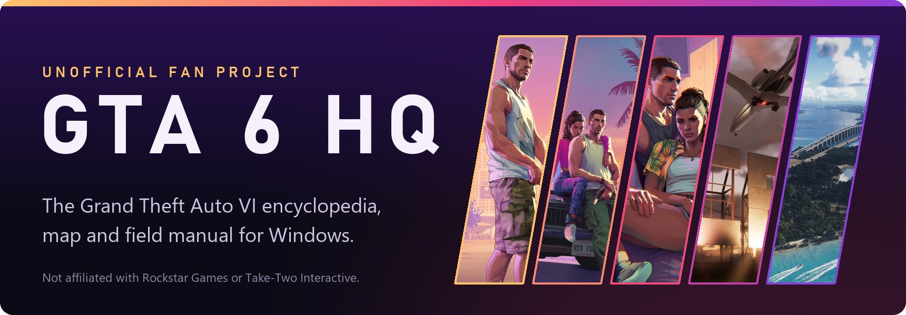</h1>

**Sourced, labelled by how well each fact is supported, and built as a small Rust desktop app.**

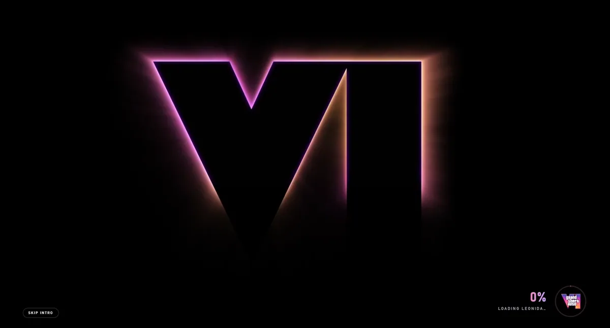

<a href="https://github.com/xpbeats00-sudo/gta6-hq/releases/latest"></a>

[](https://github.com/xpbeats00-sudo/gta6-hq/releases/latest)
[](https://github.com/xpbeats00-sudo/gta6-hq/releases)
[](https://discord.gg/YhMHr8N4an)


[Windows, Mac and Linux](#windows-mac-and-linux) · [Install](#install) · [What's inside](#whats-inside) · [The Field Manual](#the-field-manual) · [What's new](#whats-new) · [Creators welcome](#creators-welcome) · [Questions](#questions) · [How far to trust it](#how-far-to-trust-it) · [For developers](#for-developers)


</div>

> **Unofficial fan project.** Not published, approved or endorsed by Rockstar Games or Take-Two Interactive. Everything here was written before the game's release on 19 November 2026, from official footage, Rockstar's interviews and press previews.

<a id="windows-mac-and-linux"></a>
<p align="center"></p>

The same app runs on all three. Each picture below is the real app, photographed on that system.

<div align="center">

**Windows**

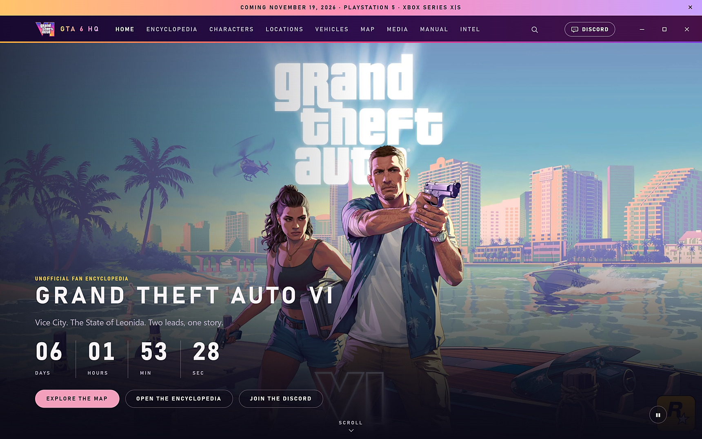

<a href="https://github.com/xpbeats00-sudo/gta6-hq/releases/latest"></a>

**macOS**

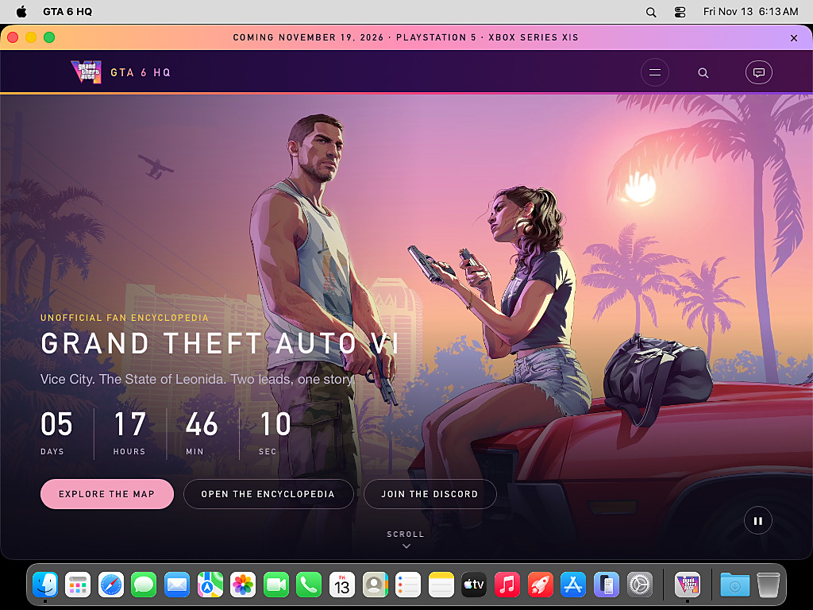

<a href="https://github.com/xpbeats00-sudo/gta6-hq/releases/latest"></a>

**Linux**

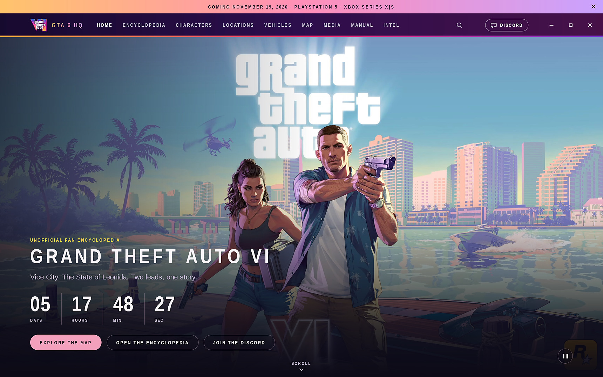

<a href="https://github.com/xpbeats00-sudo/gta6-hq/releases/latest"></a>

</div>

Each button opens the latest release. Pick `…-Setup.exe` for Windows, `…-macos.zip` for macOS or `…-linux-x86_64.tar.gz` for Linux.

The macOS and Linux versions are **previews**. They are built and tested automatically on every change (the two pictures come from those test machines), but few people have used them on a desktop of their own yet. If something is wrong, say so in the [Discord server](https://discord.gg/YhMHr8N4an) or [open an issue](https://github.com/xpbeats00-sudo/gta6-hq/issues/new/choose). How to open them is under [Install](#install).

<a id="install"></a>
<p align="center"></p>

1. Go to the [latest release](https://github.com/xpbeats00-sudo/gta6-hq/releases/latest).
2. Download `GTA6HQ-<version>-Setup.exe` and run it. It installs for your user account only and needs no administrator access.
3. Open **GTA 6 HQ** from the Start menu.

<div align="center">
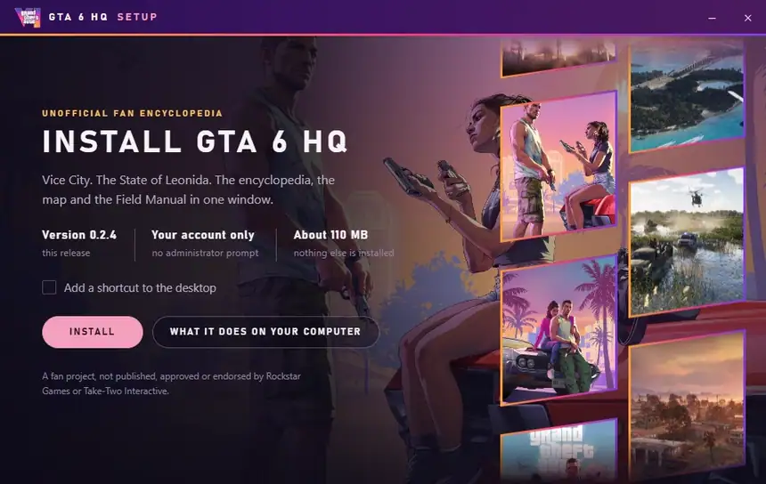
</div>

From version 0.2.4 the setup is its own window in the app's look. It still installs the ordinary way underneath, so the Start menu entry and the uninstaller work as on any Windows app.

Prefer no installer? Download the portable zip from the same page, extract it anywhere and run `gta6-hq.exe`.

**macOS (preview).** Download `GTA6HQ-<version>-macos.zip`, open it, and drag **GTA 6 HQ** into Applications. It runs on Apple silicon and Intel Macs with macOS 11 or later. The app is not signed with an Apple developer account, so the first time macOS refuses to open it: go to System Settings → Privacy & Security, scroll down and choose **Open Anyway**. On older macOS versions, right-click the app and choose **Open** instead.

**Linux (preview).** Download `GTA6HQ-<version>-linux-x86_64.tar.gz`, extract it and run `./gta6-hq` inside the `GTA6HQ` folder; `./install.sh` adds it to your applications menu. It needs WebKitGTK 4.1 (the package is usually `libwebkit2gtk-4.1-0` or `webkit2gtk4.1`) and was built on Ubuntu 22.04, so it needs a distribution at least that recent.

The macOS and Linux versions have no setup window and do not update themselves; the app's update notice links to the new release instead.

The app is not code-signed, so Windows SmartScreen may show "Windows protected your PC" the first time. Choose **More info**, then **Run anyway**. Windows 11 already includes the WebView2 runtime the app needs.

When a newer version is published, the app shows a notice. In an installed copy, **Update now** downloads the new setup from this page's releases, checks it against the release's checksums, and installs it while the app restarts. A portable copy gets a link to the release instead. Nothing downloads or installs unless you press the button.

<div align="center">
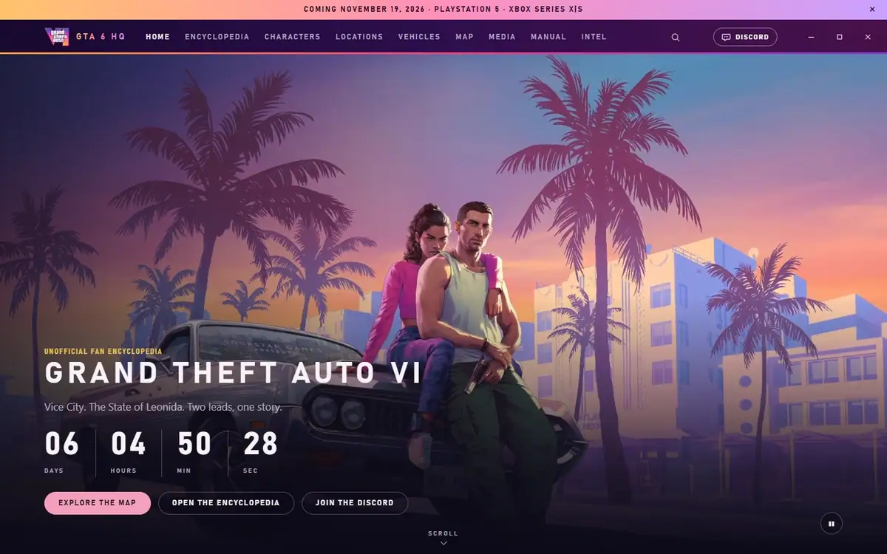
</div>

<a id="whats-inside"></a>
<p align="center"></p>

<div align="center">
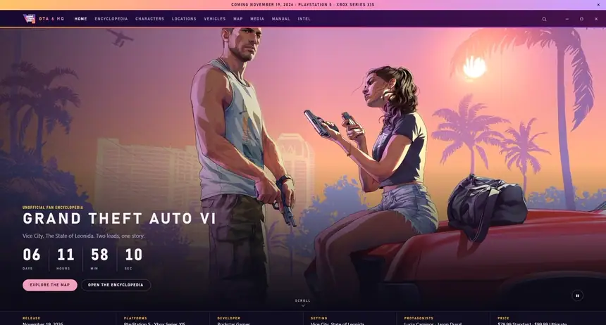
</div>

| | |
|---|---|
| **Encyclopedia** | 76 entries in 10 categories: characters, locations, vehicles, gameplay, activities, wildlife, businesses, factions, music, weapons. Each entry has a confidence label and its sources. |
| **Field Manual** | A 38-page printed-style manual with two-page spreads, search and night reading. |
| **Map** | A zoomable map of Leonida with pins for regions, districts and landmarks. |
| **Media** | Every picture and video in the app, each with where it came from and its rights status. |
| **Intel** | Release timeline, editions and the questions people ask most. |
| **Search** | Ranked search across everything, with filters. |

<table>
<tr>
<td width="50%">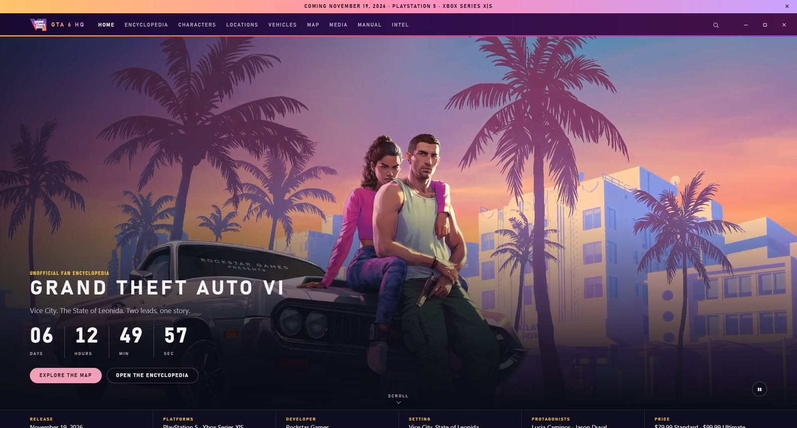</td>
<td width="50%">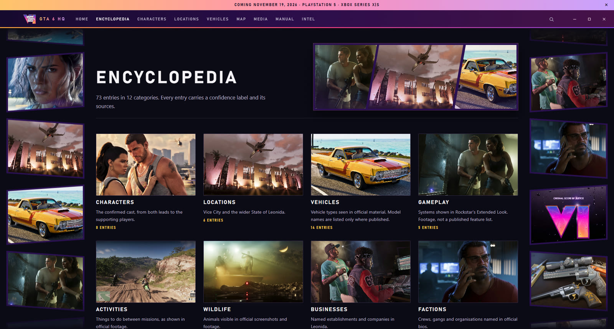</td>
</tr>
<tr>
<td>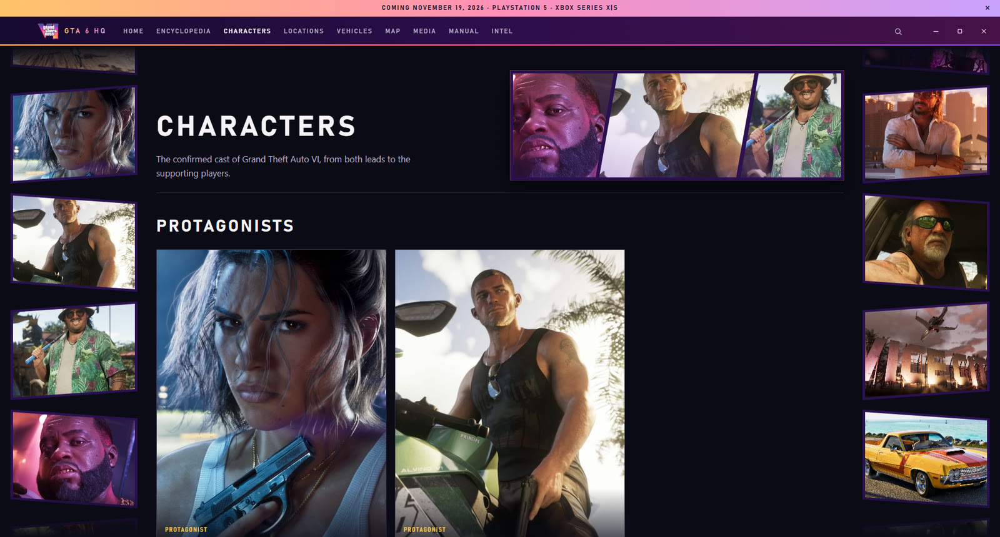</td>
<td>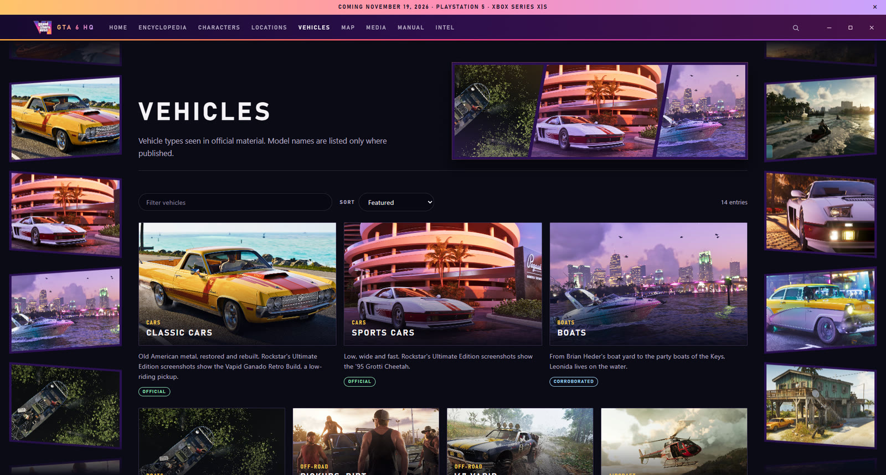</td>
</tr>
<tr>
<td>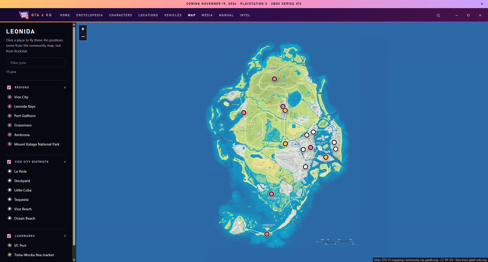</td>
<td>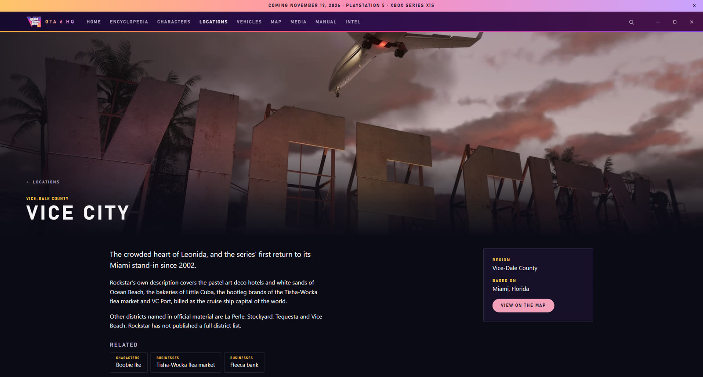</td>
</tr>
</table>

<a id="the-field-manual"></a>
<p align="center"></p>

<div align="center">
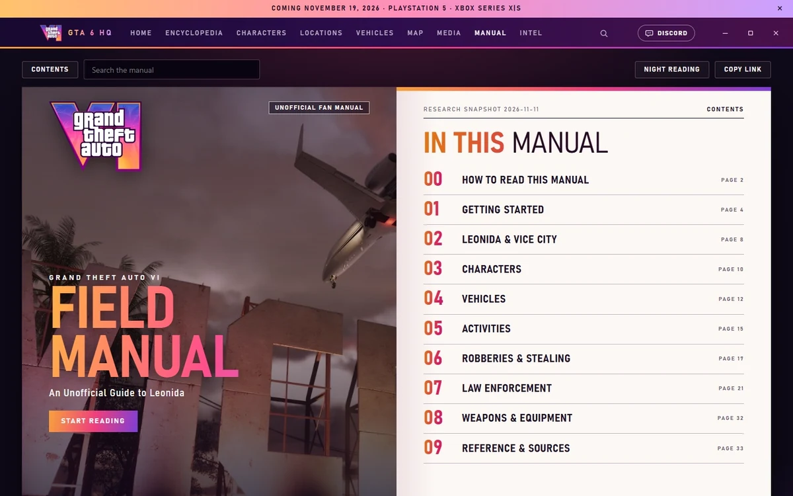
</div>

Ten chapters, written like the manual that used to come in the box:

- **Getting Started**: what is on screen, health and food, switching between Jason and Lucia, the phone and money.
- **Robberies & Stealing**: robbing stores, safes and back doors, stealing cars, guns and fighting.
- **Law Enforcement**: the six wanted stars, the Heat icons, what the police know about you and how to lose them, built on frames from Rockstar's own footage.
- **Leonida, Characters, Vehicles, Activities, Weapons**: drawn from the encyclopedia.

Click any picture to see it full screen.

<table>
<tr>
<td width="50%">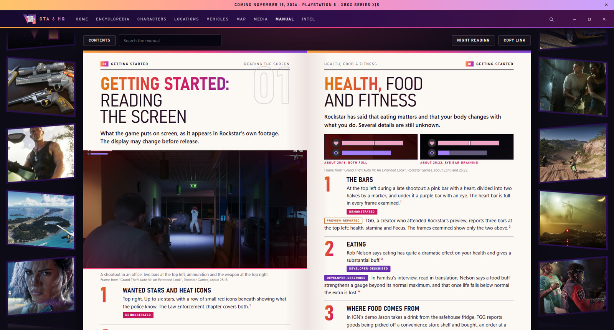</td>
<td width="50%">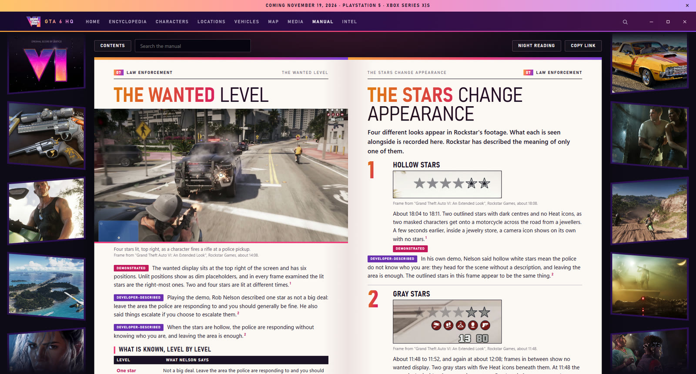</td>
</tr>
</table>

<a id="whats-new"></a>
<p align="center"></p>

- **0.2.11**: more official detail on the music, editions, rating and PlayStation 5 version, and three new entries.
- **0.2.10**: the Field Manual's day and night switch is a small Vice City scene, and the new look spreads across the page from it.
- **0.2.9**: the splash screen dissolves smoothly into Home.
- **0.2.8**: the police lights flash at a real emergency-lamp rate, and the update stage is easier to read.
- **0.2.7**: the app can update itself from Home, with police lights down the sides while it does.
- **0.2.6**: the Discord invitation on Home has a changing wallpaper, the server's icon and the Discord logo.
- **0.2.5**: Setup no longer leaves a stray folder beside the setup file.
- **0.2.4**: a new setup window in the app's look, Discord invitations on Home and above the footer, and click-to-reveal spoilers.
- **0.2.3**: a link to the [community Discord server](https://discord.gg/YhMHr8N4an) in the top bar, on Home and in the footer.
- **0.2.2**: stricter security for the app's pages, and manual pictures can be opened from the keyboard.
- **0.2.1**: Home plays every live wallpaper in turn, pictures drift slowly, and the full-screen picture viewer is fixed.
- **0.2.0**: a new look with the app's own window buttons, a 38-page manual with two new chapters, and pictures across the encyclopedia.

The full list is in [CHANGELOG.md](CHANGELOG.md), and every version is on the [releases page](https://github.com/xpbeats00-sudo/gta6-hq/releases).

<a id="creators-welcome"></a>
<p align="center"></p>

Download it, review it, stream it, make videos about it. You do not need to ask.

- Call it **unofficial** or **fan-made**, and link the [download](https://github.com/xpbeats00-sudo/gta6-hq/releases/latest) so people get the real file.
- The [press kit](docs/press/README.md) has a description to copy, screenshots and animations.
- Made something? Post it in the [Discord server](https://discord.gg/YhMHr8N4an) and we will share it.

<a id="questions"></a>
<p align="center"></p>

<details>
<summary><b>Windows says it "protected my PC". Is the app safe?</b></summary>

The app is not code-signed, because signing costs money, so Windows SmartScreen warns about it the first time. Choose **More info**, then **Run anyway**. Each release has a `SHA256SUMS.txt` you can check the download against, and all the code is in this repository.
</details>

<details>
<summary><b>Is this made by Rockstar?</b></summary>

No. It is a fan project, not published, approved or endorsed by Rockstar Games or Take-Two Interactive.
</details>

<details>
<summary><b>How do I update?</b></summary>

When a newer version exists, the app shows a notice. From version 0.2.7, an installed copy can update itself: press **Update now** and the app downloads the new setup, checks it, closes, updates and opens again. On an older version or a portable copy, download the new setup or zip from the releases page; the setup installs over the old version. Nothing updates unless you ask.
</details>

<details>
<summary><b>How do I uninstall it?</b></summary>

Windows Settings → Apps → Installed apps → GTA 6 HQ → Uninstall, or "Uninstall GTA 6 HQ" in the Start menu. The portable version is removed by deleting its folder.
</details>

<details>
<summary><b>The map is blank or has missing squares.</b></summary>

The map downloads each area from gta6-wiki.org the first time you look at it, so it needs an internet connection then. Areas you have already viewed work offline.
</details>

<details>
<summary><b>The app will not open.</b></summary>

It needs the Microsoft Edge WebView2 Runtime. Windows 11 includes it; on Windows 10, install it from Microsoft's website and try again.
</details>

<details>
<summary><b>Can I stop it showing on my Discord profile, or checking for updates?</b></summary>

Yes. In the app's folder, open `data/discord.json` or `data/update.json` and set `"enabled": false`, then restart the app.
</details>

<details>
<summary><b>Something in the encyclopedia or manual is wrong.</b></summary>

Please [open an issue](https://github.com/xpbeats00-sudo/gta6-hq/issues/new/choose) and say where you saw it and what your source is. Everything was written before release, so corrections from the finished game are welcome.
</details>

<a id="how-far-to-trust-it"></a>
<p align="center"></p>

Nothing is written from memory or carried over from earlier games. Every claim in the manual carries one of these labels:

| Label | Meaning |
|---|---|
| Demonstrated | Visible in Rockstar's official footage or screenshots |
| Developer-described | Said by a Rockstar developer in an interview |
| Preview-reported | Reported by someone who saw a preview build |
| Interpretation | A reasonable reading of footage or reporting, not a confirmed rule |
| Unknown | Not established by anything read; listed, not guessed |

Every chapter was written before release, so all of it needs checking against the finished game. The evidence behind the manual is in [`docs/manual/research/`](docs/manual/research/), and the current state of the project is in [`docs/status/CURRENT-STATE.md`](docs/status/CURRENT-STATE.md).

<a id="privacy"></a>
<p align="center"></p>

- No account, no telemetry, no analytics.
- The app asks GitHub whether a newer version exists, and the map downloads its tiles from gta6-wiki.org the first time each area is viewed.
- If Discord is running, the app can show "GTA 6 HQ" and the page you are reading on your profile.

The update check and the Discord status can each be turned off in the app's `data` folder. Details: [`docs/architecture/NETWORK-AND-PRIVACY.md`](docs/architecture/NETWORK-AND-PRIVACY.md).

<a id="credits-and-rights"></a>
<p align="center"></p>

- **Pictures, footage frames and artwork** are official Rockstar Games material and remain the property of Rockstar Games and Take-Two Interactive. Their source and rights status are recorded per file in `data/media.json`; none is licensed for redistribution, as [`docs/compliance/MEDIA-RIGHTS-AUDIT.md`](docs/compliance/MEDIA-RIGHTS-AUDIT.md) sets out. If you are a rights holder and want something removed, [open a rights request](https://github.com/xpbeats00-sudo/gta6-hq/issues/new/choose).
- **Map tiles**: the GTA VI mapping community via gtadb.org, CC BY 4.0, served by gta6-wiki.org and cached locally on first view.
- **Live wallpapers and the logo** were supplied by the app's owner; where they first came from is not recorded.

Grand Theft Auto and related names are trademarks of their owners.

<a id="for-developers"></a>
<p align="center"></p>

<details>
<summary>Building, adding content and how it is put together</summary>

### Run it from source

```bash
cargo run --release
```

The window opens on the splash video, then the app. The built program is
`target/release/gta6-hq.exe`; it needs the `ui`, `data`, `images` and
`wallpapers` folders, which it finds by looking upwards from where it sits.
It needs the Microsoft Edge WebView2 Runtime, which Windows 11 includes.

Other ways to start it:

| Command | What it does |
| --- | --- |
| `gta6-hq --serve --port 4600` | Server only; open `http://127.0.0.1:4600` in a browser |
| `gta6-hq --validate` | Print the data integrity report; exit code 1 if there are errors |
| `gta6-hq --template <category>` | Print an empty entry for that category, ready to fill in (`--csv` prints a CSV header row instead) |
| `gta6-hq --import <file> [--dry-run] [--update]` | Check a JSON or CSV batch of entries and add it; refuses the whole batch if anything is wrong |

The release program has no console window. In PowerShell, end these commands
with `| Out-Host` so the output is shown and `$LASTEXITCODE` is set, for example
`.\target\release\gta6-hq.exe --validate | Out-Host`. `cargo run -- --validate`
works as it is.

### Adding content

Read `docs/Raw/EDITORIAL_POLICY.md` first: nothing goes in without a source.
For adding a lot at once, read `docs/Raw/LAUNCH-READINESS.md`.

- **Text**: edit `data/wiki.json`, or a section file in `data/wiki/` (see
  below), and refresh. No rebuild needed. If a file has a mistake in it, the
  app says so: a broken `data/wiki.json` is replaced by the built-in copy, a
  broken section file is left out.
- **Section files**: `data/wiki/<category>.json` holds a list of entries that
  is added to that category, so a big category does not have to live in one
  huge file (`vehicles.boats.json` also counts as `vehicles`).
  `data/wiki/sources.json` adds sources. `--import` writes these files for you.
- **Many entries at once**: `gta6-hq --template vehicles` prints an entry to
  fill in; `gta6-hq --import batch.json --dry-run` checks a batch;
  without `--dry-run` it is added, after a backup in `backups/`.
- **A new category**: add it to `categories` in `data/wiki.json`, with the
  `fields` its entries may carry under `facts`.
- **A map pin**: give an entry `x` and `y` (0 to 1) and it appears on the map.
  Pin types are listed under `map.categories`.
- **Pictures for an entry**: save as `images/<section>/<slug>.jpg` (or png/webp),
  e.g. `images/characters/cal-hampton.jpg`. Entries without a picture get
  generated postcard art.
- **Gallery**: put new files in `staging/` (never shown), then move them to
  `images/` or `wallpapers/` and add a record to `data/media.json`.
- Run `cargo run -- --validate` afterwards.

### Discord Rich Presence

While the app window is open, your Discord status shows GTA 6 HQ, the page
you are on and how long the app has been open. Settings are in
`data/discord.json`:

| Setting | Meaning |
| --- | --- |
| `enabled` | `false` turns it off completely |
| `application_id` | The Application ID from the Discord Developer Portal |
| `large_image` | Name of an image uploaded under Rich Presence → Art Assets for that application |
| `show_page` | `false` shows only that the app is open, not which page |

Search terms are never sent. Discord must be running on the same computer;
if it is not, the app works as normal and retries every 15 seconds.
`http://127.0.0.1:<port>/api/presence` reports whether it is connected.
Restart the app after changing the file.

### How it is built

| File | Job |
| --- | --- |
| `src/main.rs` | Starts the server, then the window (or `--serve` / `--validate`) |
| `src/window.rs` | Native window (tao) with a web view (wry / WebView2) |
| `src/server.rs` | Routes: `/api/wiki`, `/api/search`, `/api/media`, `/api/health`, `/tiles/…`, static files |
| `src/content.rs` | Loads `data/wiki.json` and `data/wiki/*.json`, attaches entry images, keeps the result in memory until a file changes |
| `src/search.rs` | Word index built once per load; ranking, filters, paging |
| `src/import.rs` | `--template` and `--import`: batch checks, backups, atomic writes |
| `src/media.rs` | Scans `images/` and `wallpapers/`, joins the rights manifest |
| `src/validate.rs` | Data and media integrity report (also used by `--import`) |
| `src/tiles.rs` | Fetches map tiles once and caches them in `cache/tiles/` |
| `src/discord.rs` | Discord Rich Presence over Discord's local connection |
| `ui/` | The interface (HTML, CSS, JavaScript, Leaflet) |

Checks: `cargo test`, `cargo clippy --all-targets --all-features -- -D warnings`,
`cargo fmt --all -- --check`, `node --check ui/app.js`.

`/api/search` answers `{ total, offset, limit, hits }` and takes `q`, `section`,
`limit` (default 50, at most 200), `offset`, `sort=name`, `rumors=true` and
`spoilers=true`. `/api/wiki` has the same shape as before, minus draft entries.


### Project status and reports

Start with [docs/status/CURRENT-STATE.md](docs/status/CURRENT-STATE.md). It is generated from the live data:

```
python scripts/current_state.py --run-checks
python scripts/audit_media.py
```

[docs/status/REPORT-INDEX.md](docs/status/REPORT-INDEX.md) lists every report and says which are current and which are history.

### Publishing an update

Releases are published at https://github.com/xpbeats00-sudo/gta6-hq/releases. When the app opens it asks GitHub whether a newer release exists and, if so, shows a notice with a link; nothing is downloaded or installed automatically. To turn the check off, set `"enabled": false` in `data/update.json`.

To publish a new version: raise `version` in `Cargo.toml`, run `cargo build --release` (with the app closed), then `python scripts/package_release.py`. That writes the installer (`installer/gta6-hq.iss`, needs Inno Setup 6), the portable zip and their checksums to `dist/`; attach all three to a new GitHub release tagged `v<version>`.

The file people download is the setup window in `installer/shell` (a small Rust program using the same window technology as the app). It carries the Inno Setup installer built from `installer/gta6-hq.iss`, runs it silently and reads its log for progress; if the window cannot open, it runs that installer with its own pages. `gta6-hq-setup.exe --demo` shows the pages without installing anything, and `python scripts/make_installer_art.py` redraws its pictures.

The installer puts the app in the user's own programs folder, so it needs no administrator access and the app can write its map cache beside itself.

</details>

<div align="center">


**GTA 6 HQ** is an unofficial fan project. [Download](https://github.com/xpbeats00-sudo/gta6-hq/releases/latest) · [Discord](https://discord.gg/YhMHr8N4an) · [Press kit](docs/press/README.md)

</div>
